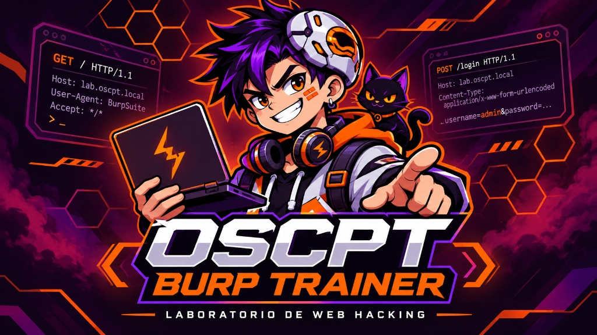

<div align="center">



# 🎯 OSCPT Burp Trainer
### Laboratorio Práctico de Web Hacking con Burp Suite

**Escenario Corporativo:** *Novera Group / PeopleHub*  
**Plataforma de Retos:** *Secuencial estilo TryHackMe / Hack The Box con 23 Desafíos*

[](https://www.docker.com/)
[](https://portswigger.net/burp)
[](http://localhost:8010/help/settings)
[](https://github.com/bitsofalber/oscp-burpsuite-learn)

</div>

---

## 📋 Resumen del Escenario

Bienvenido a **PeopleHub**, la intranet corporativa del grupo ficticio *Novera Group*. A través de 23 desafíos organizados en 6 módulos progresivos, auditarás la aplicación utilizando **Burp Suite** para descubrir:

- 🌐 **Reconocimiento:** Mapeo de rutas, identificación de tecnologías y análisis de código estático.
- 📡 **Inspección HTTP:** Métodos HTTP (GET/POST), análisis de parámetros de cuerpo y formularios.
- 👤 **Enumeración de Usuarios:** Detección de comportamientos diferenciales en respuestas (404 vs 401).
- 🧩 **Fugas de Información en APIs:** Extracción de datos sensibles en respuestas JSON no mostradas en la interfaz.
- 🔑 **Credenciales Expuestas:** Localización de accesos documentados y secretos en comentarios JavaScript.
- 🚪 **Movimiento Lateral:** Acceso al portal interno secundario de operaciones (*People Operations*).
- ⚡ **Escalada Administrativa:** Construcción manual de peticiones POST JSON para comprometer la plataforma y capturar la **Flag de Administrador**.

---

## 🛠️ Requisitos Previos

- **Docker y Docker Compose** instalados en tu sistema operativo.
- **Burp Suite** (versión *Community Edition* o *Professional*).
- **No necesitas instalar Python, Flask, pip ni crear entornos virtuales:** todo el entorno corre 100% encapsulado y aislado dentro del contenedor Docker.

---

## 🚀 Guía de Despliegue Paso a Paso

Elige tu sistema operativo a continuación para poner en marcha el laboratorio:

### 🐧 En Linux (Ubuntu, Kali Linux, Debian, Arch, etc.)

Si estás en tu máquina Linux o en una distribución de pentesting (como Kali Linux):

#### 1. Entrar en la carpeta del laboratorio
Abre tu terminal y navega hasta el directorio de este laboratorio:
```bash
cd oscp-burpsuite-learn/OSCPT-Burp-Trainer
```

#### 2. Asegurarse de que el servicio de Docker esté corriendo
```bash
sudo systemctl start docker
```

#### 3. Levantar el laboratorio en segundo plano
Ejecuta Docker Compose con el flag `-d` para que compile la imagen y se quede corriendo en segundo plano:
```bash
docker compose up -d --build
```
> [!NOTE]  
> Si tu usuario no pertenece al grupo `docker`, ejecuta el comando con `sudo`:  
> `sudo docker compose up -d --build`  
> *(Para añadir tu usuario al grupo docker y no requerir sudo: `sudo usermod -aG docker $USER` y reinicia sesión).*

#### 4. Verificar que el laboratorio está activo
Comprueba el estado del contenedor:
```bash
docker compose ps
```
Deberás ver el servicio `oscpt-burp-trainer` en estado `Up` y publicando el puerto `127.0.0.1:8010`.

#### 5. Consultar los logs en tiempo real (opcional)
Si deseas ver las peticiones que llegan al servidor o depurar:
```bash
docker compose logs -f
```
*(Para salir del visor de logs pulsa `Ctrl + C`; el laboratorio seguirá funcionando en segundo plano).*

---

### 🍏 En macOS

Tienes dos opciones de inicio:

- **Opción A (1 Clic):** Abre la carpeta en Finder y haz doble clic sobre el archivo **`Iniciar-Mac.command`**.  
  *(Si macOS te muestra una advertencia de seguridad la primera vez, abre la terminal en esta carpeta, ejecuta `chmod +x Iniciar-Mac.command` y vuelve a abrirlo).*
- **Opción B (Terminal):** Abre tu terminal en esta carpeta y ejecuta:
  ```bash
  docker compose up -d --build
  ```

---

### 🪟 En Windows

- **Opción A (1 Clic):** Abre Docker Desktop y haz doble clic sobre el archivo **`Iniciar-Windows.bat`**.
- **Opción B (PowerShell / CMD):**
  ```powershell
  docker compose up -d --build
  ```

---

## 🌐 URLs de Acceso al Laboratorio

Una vez iniciado el contenedor, abre tu navegador web o el navegador integrado de Burp Suite:

| Servicio | URL Local | Descripción |
| :--- | :--- | :--- |
| **Plataforma de Retos (CTF)** | [http://localhost:8010/help](http://localhost:8010/help) | **Acceso libre e inmediato (sin registro ni login previo)**. Sala de retos interactiva con los 23 objetivos, pistas y retroalimentación en tiempo real. |
| **Aplicación Objetivo** | [http://localhost:8010/](http://localhost:8010/) | Portal corporativo *PeopleHub* de Novera Group (el objetivo web que debes auditar). |
| **Nivel de Ayuda** | [http://localhost:8010/help/settings](http://localhost:8010/help/settings) | Selector entre **Modo Aprendizaje** (con guía de herramientas Burp), **Modo Guiado** y **Modo Examen**. |
| **Comprobación de Salud** | [http://localhost:8010/health](http://localhost:8010/health) | Endpoint de verificación del servicio (`{"status": "ok"}`). |

---

## 🎯 Metodología de Auditoría con Burp Suite

1. **Abrir Burp Suite:** Inicia Burp Suite en tu equipo.
2. **Usar el navegador integrado (Recomendado):**
   - Ve a la pestaña **Proxy** > **Open browser**.
   - El navegador integrado viene preconfigurado con el certificado CA y envía todo el tráfico al proxy automáticamente sin requerir extensiones adicionales.
3. **Comenzar la investigación:**
   - Mantén abierta una pestaña en la **Plataforma de Retos** ([http://localhost:8010/help](http://localhost:8010/help)) para consultar las preguntas y enviar respuestas.
   - Navega por la **Aplicación Objetivo** ([http://localhost:8010/](http://localhost:8010/)) mientras observas las peticiones en **Proxy > HTTP history**.
4. **Formato de respuesta interactivo:**
   - Cada tarea cuenta con una máscara de asteriscos (`**`) que te indica la cantidad exacta de caracteres y los símbolos que componen la solución (ejemplo: `/*****` para `/login` o `***.**` para `app.js`).
   - Cada respuesta acertada desbloquea la siguiente tarea automáticamente.
5. **Flag de Administrador (Objetivo Final):**
   - El apartado de la bandera final en `/help/final` está **siempre abierto**. Si consigues acceder a `/ops/admin` directamente o por otra vía alternativa, puedes enviar la flag en cualquier momento sin necesidad de haber completado las 23 tareas previas.

---

## 🛑 Detener y Limpiar el Laboratorio (Sin dejar basura)

Cuando termines tu sesión de práctica y quieras apagar el laboratorio eliminando contenedores, redes, el volumen de base de datos SQLite y las imágenes locales para que no ocupen espacio en disco:

### En Linux:
Ejecuta el script de limpieza automatizado:
```bash
./stop_and_erase.sh
```
O directamente con Docker:
```bash
docker compose down --rmi all --volumes --remove-orphans
```

### En macOS:
- Doble clic en **`Detener-y-Borrar-Mac.command`** o ejecuta `./stop_and_erase.sh`.

### En Windows:
- Doble clic en **`Detener-y-Borrar-Windows.bat`** (o `stop_and_erase.bat`).

---

## 🔧 Solución de Problemas Frecuentes (Troubleshooting)

### 1. `permission denied while trying to connect to the Docker daemon socket` (en Linux)
Tu usuario no tiene permisos para hablar con el demonio de Docker sin `sudo`.
- **Solución rápida:** Ejecuta los comandos con `sudo` (ejemplo: `sudo docker compose up -d --build`).
- **Solución permanente:** Añade tu usuario al grupo docker:
  ```bash
  sudo usermod -aG docker $USER
  newgrp docker
  ```

### 2. `Bind for 127.0.0.1:8010 failed: port is already allocated`
Significa que otro proceso o contenedor ya está utilizando el puerto 8010.
- Comprueba qué contenedor lo está ocupando con:
  ```bash
  docker ps | grep 8010
  ```
- O localiza el proceso en tu máquina con:
  ```bash
  sudo lsof -i :8010
  ```

---

## ⚠️ Uso Autorizado

Este laboratorio ha sido creado con fines estrictamente educativos y para la preparación de exámenes de certificación técnica en entornos locales controlados. No expongas este servicio a redes públicas ni a Internet.
