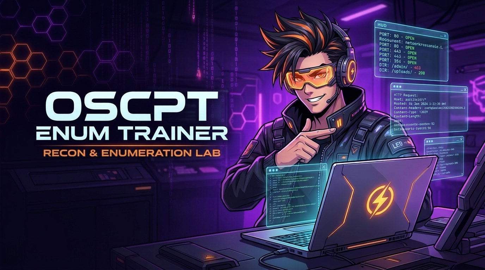

<div align="center">



# 🎯 OSCPT Enum Trainer (Lab 2)
### Laboratorio Práctico de Reconocimiento, Enumeración, Intruder y Decoder

**Escenario Corporativo:** *Novera Group / DevPortal*  
**Plataforma de Retos:** *Secuencial estilo TryHackMe / Hack The Box con 16 Desafíos y 2.150 Puntos*

[](https://www.docker.com/)
[](https://portswigger.net/burp)
[-f59e0b?style=flat-square)](http://localhost:8011/help/)
[](https://github.com/bitsofalber/oscp-burpsuite-learn)

</div>

---

## 📋 Resumen del Escenario

En esta segunda entrega de la serie **OSCP Burp Suite Learn**, el equipo de desarrollo de *Novera Group* ha desplegado **DevPortal**, una plataforma interna diseñada para administrar APIs, rotar tokens y gestionar accesos de desarrolladores.

A través de **16 retos prácticos organizados en 6 módulos progresivos**, pondrás a prueba técnicas esenciales para la certificación **OSCP** y pruebas de penetración reales:

- 🔍 **Reconocimiento Pasivo:** Identificación de tecnologías mediante headers (`X-Powered-By`), auditoría de directivas de indexación (`robots.txt`) y filtraciones en comentarios HTML.
- 📁 **Enumeración de Endpoints & Fuzzing:** Mapeo de especificaciones API v1, descubrimiento de parámetros ocultos (`debug`) y localización de archivos residuales de copia de seguridad (`config.bak`).
- 👤 **Enumeración de Usuarios:** Explotación de respuestas de login asimétricas (*User Enumeration* por mensaje de error) y extracción del directorio completo de cuentas con Bearer tokens.
- 💥 **Burp Intruder & Brute Force:** Ataque de diccionario a PINs numéricos de 4 dígitos, descubrimiento de tokens de reseteo secuenciales codificados y fuzzing de identificadores IDOR/REST (`/keys/{id}`).
- 🔓 **Burp Decoder & Análisis Criptográfico/Encodings:** Decodificación de cookies de estado en Base64, payloads de tokens JWT (claims `sub`), análisis de redirecciones URL-encoded y desofuscación de credenciales en formato Hexadecimal.
- 🏁 **Escalada de Privilegios & Flag Final:** Autenticación administrativa, obtención de tokens maestros (`X-Admin-Token`) y compromiso total de la plataforma en `/devportal/admin/flag`.

---

## 🗺️ Mapa de Módulos y Retos

| Módulo | Nombre | Retos | Técnicas / Herramientas Clave |
| :---: | :--- | :---: | :--- |
| **01** | **🔍 Reconocimiento Pasivo** | R1 – R3 | Headers HTTP, `robots.txt`, Comentarios HTML, Repeater |
| **02** | **📁 Enumeración de Endpoints** | E1 – E4 | API Docs, Fuzzing de parámetros (`debug`), Archivos `.bak`, Extracción de API Token |
| **03** | **👤 Enumeración de Usuarios** | U1 – U3 | Error-Based User Enumeration, Bearer Auth, Directory Harvesting |
| **04** | **💥 Intruder & Brute Force** | I1 – I4 | Intruder Sniper (Numbers 4-digit PIN), Base64 Reset Token, Key IDs, JWT Payload |
| **05** | **🔓 Decoder & Análisis** | D1 – D3 | Decoder Base64, URL Decode de Redirects 302, Hex to String decoding |
| **06** | **🏁 Escalada Final** | F1 – F2 | Admin Login JSON, Header `X-Admin-Token`, Acceso a Flag Final |

---

## 🛠️ Requisitos Previos

- **Docker y Docker Compose** instalados en tu máquina.
- **Burp Suite** (*Community Edition* o *Professional*).
- **No requieres configurar entornos de Python, pip ni librerías adicionales:** todo se ejecuta dentro del contenedor de manera segura e independiente.

---

## 🚀 Guía de Despliegue Paso a Paso

Elige tu sistema operativo a continuación para arrancar el laboratorio:

### 🐧 En Linux (Ubuntu, Kali Linux, Debian, Arch, etc.)

#### 1. Acceder a la carpeta del laboratorio
```bash
cd oscp-burpsuite-learn/OSCPT-Enum-Trainer
```

#### 2. Iniciar el servicio Docker (si no está activo)
```bash
sudo systemctl start docker
```

#### 3. Levantar el laboratorio en segundo plano
```bash
docker compose up -d --build
```
> [!TIP]  
> Si tu usuario no pertenece al grupo `docker`, ejecuta el comando con `sudo`:  
> `sudo docker compose up -d --build`

#### 4. Verificar el estado del contenedor
```bash
docker compose ps
```
El servicio `oscpt-enum-trainer` aparecerá en estado `Up` escuchando en el puerto `127.0.0.1:8011`.

#### 5. Ver logs en tiempo real (opcional)
```bash
docker compose logs -f
```

---

### 🍏 En macOS

Tienes dos opciones rápidas:

- **Opción A (Doble Clic):** Haz doble clic en el archivo **`Iniciar-Mac.command`** en Finder.  
  *(Si te solicita permisos de ejecución: abre terminal en la carpeta y escribe `chmod +x Iniciar-Mac.command`).*
- **Opción B (Terminal):**
  ```bash
  docker compose up -d --build
  ```

---

### 🪟 En Windows

Tienes dos alternativas:

- **Opción A (Doble Clic):** Ejecuta con doble clic el archivo **`Iniciar-Windows.bat`**.
- **Opción B (PowerShell / Terminal):**
  ```powershell
  docker compose up -d --build
  ```

---

## 🌐 URLs de Acceso

Una vez levantado el contenedor:

| Servicio | URL Local | Descripción |
| :--- | :--- | :--- |
| **DevPortal (Target)** | [http://localhost:8011/devportal/](http://localhost:8011/devportal/) | Portal de desarrollo de Novera Group (objetivo de auditoría) |
| **Plataforma de Retos** | [http://localhost:8011/help/](http://localhost:8011/help/) | Plataforma interactiva de desafíos, pistas y progreso |
| **Progreso del Alumno** | [http://localhost:8011/help/progress](http://localhost:8011/help/progress) | Resumen de puntos, puntuación y retos superados |
| **Flag Final** | [http://localhost:8011/help/final](http://localhost:8011/help/final) | Verificación y entrega de la flag final |

---

## 🦊 Configuración con Burp Suite

1. Abre **Burp Suite** y ve a la pestaña **Proxy → Intercept**.
2. Abre el navegador integrado de Burp haciendo clic en **Open Browser**.
3. Navega a `http://localhost:8011/help/` para ver los retos y a `http://localhost:8011/devportal/` para comenzar las pruebas.
4. En **Proxy → HTTP history**, verás cómo se registran todas las peticiones hacia el puerto `8011`.
5. Utiliza **Repeater** (`Ctrl + R` / `Cmd + R`), **Intruder** (`Ctrl + I` / `Cmd + I`) y **Decoder** para resolver cada módulo según las sugerencias en pantalla.

---

## 🧹 Cómo Detener y Limpiar el Laboratorio

Cuando termines tu sesión de práctica y quieras apagar el laboratorio liberando todos los recursos:

### En Linux
```bash
./stop_and_erase.sh
```
*O manualmente mediante:*
```bash
docker compose down --rmi all --volumes --remove-orphans
```

### En macOS
- Haz doble clic en el lanzador **`Detener-y-Borrar-Mac.command`**.

### En Windows
- Haz doble clic en **`Detener-y-Borrar-Windows.bat`**.

---

## ⚖️ Licencia y Créditos

- **Autor:** Alberto Hidalgo Moreno ([@bitsofalber](https://github.com/bitsofalber))
- **Proyecto:** [OSCP Burp Suite Learn](https://github.com/bitsofalber/oscp-burpsuite-learn)
- **Licencia:** MIT — Diseñado con fines exclusivamente educativos para la preparación de certificaciones ofensivas (OSCP, OSWP, eWPT).
