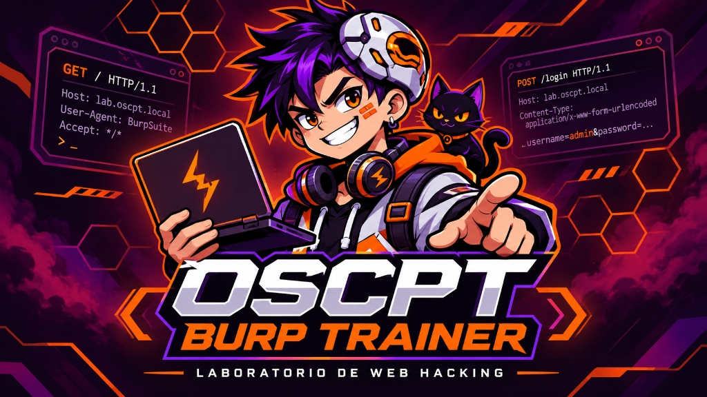
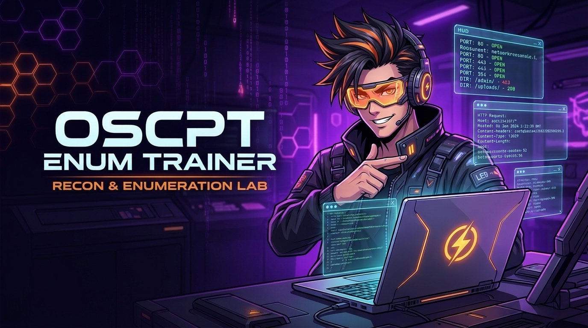

<div align="center">

# 🛡️ OSCPT Burp Suite Labs

**Colección de laboratorios prácticos y autoalojados (*self-hosted*) de Burp Suite orientados a pentesting web y preparación para la certificación OSCP / OSCPT.**

[](https://www.docker.com/)
[](https://www.python.org/)
[](https://portswigger.net/burp)
[](https://github.com/bitsofalber/oscp-burpsuite-learn)

<br/>

[🎯 Sobre el proyecto](#-sobre-el-proyecto) •
[🚀 Objetivos](#-objetivos-de-aprendizaje) •
[🧪 Laboratorios Disponibles](#-laboratorios-disponibles) •
[⚙️ Puesta en Marcha](#️-puesta-en-marcha-rápida) •
[📚 Metodología](#-metodología-de-trabajo) •
[👨‍💻 Autor](#-autor-y-contacto)

</div>

---

## 🎯 Sobre el proyecto

**OSCPT Burp Suite Labs** es un repositorio estructurado de laboratorios prácticos, interactivos y locales diseñados para aprender y dominar **Burp Suite** mediante escenarios realistas de análisis y pruebas de seguridad en aplicaciones web.

El proyecto está orientado a estudiantes y profesionales que se preparan para certificaciones de seguridad ofensiva como **OSCP** (*OffSec Certified Professional*) y buscan consolidar una metodología sólida de análisis HTTP, interceptación, manipulación de peticiones y enumeración web.

> [!TIP]
> Cada laboratorio es **completamente autónomo**, se ejecuta en un entorno aislado con Docker (sin necesidad de instalar Python ni librerías en tu sistema operativo) y cuenta con una interfaz de resolución secuencial interactiva estilo **TryHackMe / Hack The Box**.

---

## 🚀 Objetivos de Aprendizaje

- 📡 **Comprender la comunicación HTTP/S:** análisis profundo de encabezados, métodos, parámetros y códigos de estado.
- 🎯 **Dominio de Burp Suite:** uso ágil de *Proxy*, *HTTP history*, *Repeater*, *Target Site map* e *Inspector*.
- 🔍 **Técnicas de Enumeración Web:** descubrimiento de endpoints, directorios ocultos y rutas no enlazadas.
- 🔑 **Auditoría de Autenticación y Sesiones:** análisis de respuestas diferenciales (404 vs 401), tokens y cookies.
- 🧩 **Inspección de APIs REST:** extracción de datos en llamadas JSON en segundo plano y parámetros no expuestos en la interfaz.
- 🏆 **Mentalidad Metodológica:** enfocar las auditorías de forma ordenada, replicando escenarios reales de certificación.

---

## 🧪 Laboratorios Disponibles

| Laboratorio | Descripción | Enfoque Principal | Puerto | Estado | Enlace directo |
| :--- | :--- | :--- | :---: | :---: | :---: |
| **OSCPT Burp Trainer (Lab 1)** | Intranet corporativa (*PeopleHub* de Novera Group) con 23 tareas guiadas, pistas por niveles y bandera de administrador. | Proxy, Repeater, APIs JSON, Bypasses de autenticación | `8010` | `🟢 Disponible` | [Abrir Laboratorio](./OSCPT-Burp-Trainer/) |
| **OSCPT Enum Trainer (Lab 2)** | Portal de desarrolladores (*DevPortal* de Novera Group) con 16 retos interactivos, fuzzing, brute force y decodificación. | Reconocimiento, Fuzzing, Intruder, Decoder, JWT, Hex | `8011` | `🟢 Disponible` | [Abrir Laboratorio](./OSCPT-Enum-Trainer/) |
| *Próximo Laboratorio* | Escenario centrado en SQL Injection, bypass de filtros y Broken Access Control. | SQLi, IDOR, Privilege Escalation | `8012` | `🟡 En desarrollo` | — |

<br/>

<div align="center">
  <a href="./OSCPT-Burp-Trainer/">
    
  </a>
  <p><small><i>Lab 1: OSCPT Burp Trainer (PeopleHub - Fundamentos & Autenticación)</i></small></p>

  <a href="./OSCPT-Enum-Trainer/">
    
  </a>
  <p><small><i>Lab 2: OSCPT Enum Trainer (DevPortal - Recon, Fuzzing, Intruder & Decoder)</i></small></p>
</div>

*Se irán incorporando nuevos laboratorios y escenarios progresivamente.*

---

## 🛠️ Stack Tecnológico

- **Herramienta de Pentesting:** Burp Suite Community / Professional Edition
- **Infraestructura:** Docker & Docker Compose
- **Backend de los laboratorios:** Python 3.12 & Flask
- **Base de datos:** SQLite (volúmenes aislados y reseteables)
- **Protocolos y APIs:** HTTP/1.1, REST APIs, JSON

---

## ⚙️ Puesta en Marcha Rápida

Cada laboratorio cuenta con su propia documentación específica y lanzadores de un solo clic. El flujo general es:

### 1. Clonar el repositorio

```bash
git clone https://github.com/bitsofalber/oscp-burpsuite-learn.git
cd oscp-burpsuite-learn
```

### 2. Acceder al laboratorio deseado

Por ejemplo, para iniciar el laboratorio **OSCPT Burp Trainer**:

```bash
cd OSCPT-Burp-Trainer
```

### 3. Iniciar el entorno (1-Clic)

- **macOS:** Haz doble clic en `Iniciar-Mac.command` (o ejecuta `./Iniciar-Mac.command`).
- **Windows:** Haz doble clic en `Iniciar-Windows.bat`.
- **Linux / Terminal:** Ejecuta `docker compose up --build`.

El laboratorio quedará desplegado localmente en:
- **Plataforma de Retos (Sin login necesario):** [http://localhost:8010/help](http://localhost:8010/help)
- **Aplicación Objetivo (*PeopleHub*):** [http://localhost:8010/](http://localhost:8010/)

### 4. Detener y limpiar sin dejar residuos

Para detener el laboratorio y eliminar contenedores, volúmenes de datos e imágenes construidas:
- **macOS:** Doble clic en `Detener-y-Borrar-Mac.command` o `./stop_and_erase.sh`.
- **Windows:** Doble clic en `Detener-y-Borrar-Windows.bat` o `stop_and_erase.bat`.

---

## 📚 Metodología de Trabajo

Los laboratorios siguen un flujo de 5 fases estructuradas:

```text
[ 1. Aprender ] ──► [ 2. Explorar ] ──► [ 3. Interceptar ] ──► [ 4. Investigar ] ──► [ 5. Resolver ]
 Comprender la       Navegar y mapear    Capturar tráfico con    Manipular peticiones    Completar el reto
 funcionalidad       la aplicación       Burp Proxy              en Burp Repeater        y obtener la flag
```

1. **Aprender:** Analizar la arquitectura de la aplicación y la tecnología subyacente.
2. **Explorar:** Navegar por la interfaz descubriendo funcionalidades y enlaces.
3. **Interceptar:** Pasar el tráfico a través de Burp Suite e inspeccionar las peticiones HTTP.
4. **Investigar:** Manipular verbos, parámetros y cabeceras en Burp Repeater para analizar el comportamiento del backend.
5. **Resolver:** Introducir la evidencia encontrada en la plataforma de retos para desbloquear el siguiente objetivo.

---

## 🎓 Enfoque y Preparación OSCP

El objetivo de este proyecto es reforzar las habilidades prácticas de pentesting web requeridas en la certificación **OSCP**:

- No se trata únicamente de memorizar botones de una herramienta, sino de **interiorizar una metodología analítica**.
- Aprender a detectar discrepancias entre lo que muestra la interfaz web y lo que devuelven las APIs internas.
- Practicar la construcción manual y controlada de peticiones sin depender de herramientas automáticas.

---

## ⚠️ Aviso Legal / Disclaimer

Este proyecto y sus laboratorios tienen un propósito **estrictamente educativo y de formación ética**. 

Todas las pruebas deben realizarse de forma local y controlada dentro de los entornos proporcionados. El autor no se hace responsable del uso indebido o no autorizado de las técnicas y conocimientos descritos.

---

## 👨‍💻 Autor y Contacto

Creado y mantenido por **Alberto Hidalgo Moreno**.

- **GitHub:** [@bitsofalber](https://github.com/bitsofalber)
- **Marca Personal:** **BitsofAlber**
- **Repositorio Oficial:** [oscp-burpsuite-learn](https://github.com/bitsofalber/oscp-burpsuite-learn)

---

<div align="center">

*Aprende. Intercepta. Enumera. Investiga.*  
**Desarrollando habilidades prácticas de pentesting web, laboratorio a laboratorio.**

</div>
